Google Antigravity 2.0은 AI 에이전트에게 작업을 맡기고 진행 과정을 살피며 결과물을 검토하는 플랫폼입니다. 이전에는 주로 개발자용 코드 편집기 안에서 썼지만, 2.0부터는 macOS, Windows, Linux에서 따로 실행되는 Antigravity App을 중심으로 VS Code, JetBrains, Zed용 에디터 확장 프로그램, 터미널 도구인 Antigravity CLI(`agy`), Python용 Antigravity SDK까지 하나의 생태계로 묶였습니다.

여기에 웹 브라우저로 접속하는 Antigravity Web([antigravity.google.com](https://antigravity.google.com))이 더해지면서 꼭 내 컴퓨터 앞에 앉아 있지 않아도 작업을 이어갈 수 있습니다. 별도 프로그램을 설치하지 않은 PC나 스마트폰, 태블릿에서 Google 계정으로 로그인하면 에이전트가 일하는 모습을 실시간으로 보고, 중간에 필요한 승인을 누르거나 새 작업을 바로 지시할 수 있습니다.

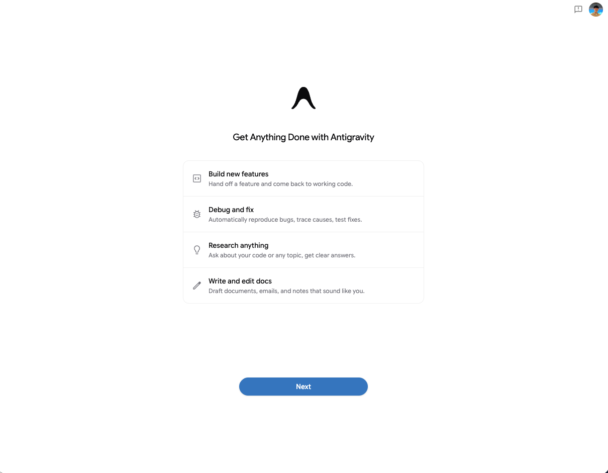

코딩이나 버그 수정 같은 개발 업무 외에도 자료 조사, 문서 초안 작성, 이메일 정리 같은 일반 사무 작업까지 같은 환경에서 처리할 수 있습니다.

## 직군에 맞춘 화면 구성과 권한 설정

개발자와 비개발자가 함께 쓰는 도구인 만큼, 설정(`Settings > General`)에서 작업 성격에 맞는 화면 구성을 고를 수 있습니다.

- Knowledge Work: 리서치, 문서 작성, 일상 업무에 집중할 수 있도록 메뉴를 단순하게 정리한 화면입니다. 파일·터미널 도구나 네트워크 세부 규칙 같은 기술 설정은 하단의 `Advanced Settings` 아래로 접혀 있어 비개발자도 부담 없이 다룰 수 있습니다.

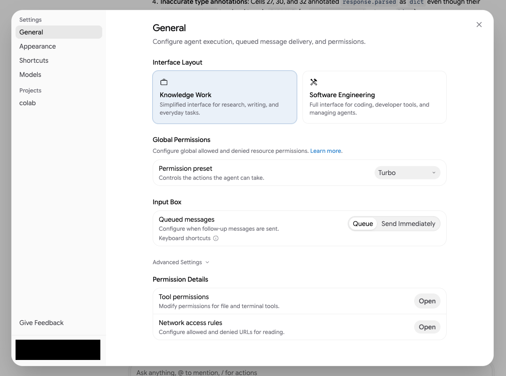

- Software Engineering: 코드 작업, 개발자 도구, 에이전트 관리 기능을 모두 열어두는 전체 화면입니다. `Global Permissions`에서 `Permission preset`, `Tool permissions`, `Network access rules`를 바로 열어 조정할 수 있습니다.

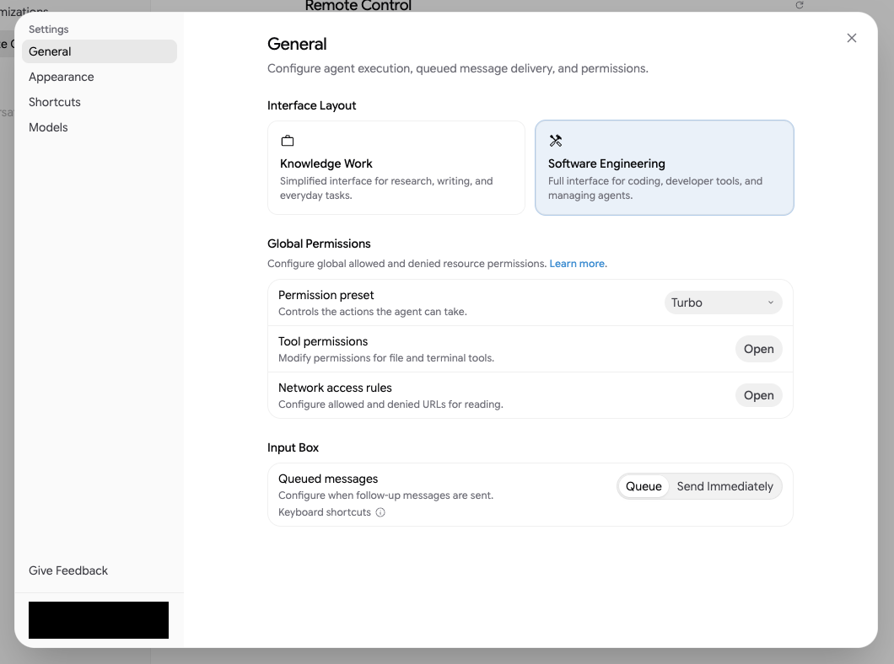

## 웹에서 쓰는 두 가지 원격 기능

Antigravity 2.0 Web의 원격 기능은 Remote Agents와 Remote Control 두 가지입니다. 둘 다 웹 브라우저에서 에이전트를 다룬다는 점은 같지만, 실제로 작업이 돌아가는 컴퓨터가 다릅니다.

Remote Agents는 Google이 관리하는 클라우드 가상 컴퓨터에서 에이전트를 실행합니다. 내 노트북을 덮거나 전원을 꺼도 클라우드에서 작업이 멈추지 않고 계속 돌아갑니다. 반면 Remote Control은 내 책상 위 PC나 서버에서 실행 중인 Antigravity에 웹 브라우저로 원격 접속해 화면을 보고 지시하는 기능입니다. 실제 연산과 파일 처리는 내 컴퓨터가 맡습니다.

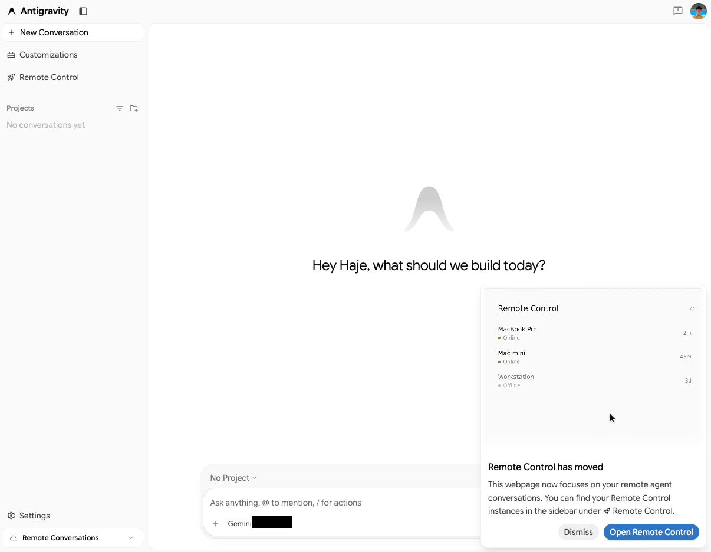

웹 화면 왼쪽 사이드바에서 클라우드 작업을 담는 `Projects` 영역과 내 기기에 원격 접속하는 `Remote Control` 메뉴를 바로 오갈 수 있습니다. 연결된 기기가 여러 대라면 각 기기의 `Online`과 `Offline` 상태를 한눈에 보고 선택합니다.

| 구분 | Remote Agents | Remote Control |
| --- | --- | --- |
| 작업이 실행되는 곳 | Google이 관리하는 격리된 클라우드 환경 | 내 로컬 PC, 노트북 또는 개인 서버 |
| 내 컴퓨터 전원 유지 | 필요 없음 (꺼두거나 절전 모드여도 계속 실행) | 필요함 (전원과 인터넷 연결 유지 필요) |
| 주로 다루는 자료 | GitHub 저장소, Google Drive, 업로드한 파일 | 내 컴퓨터 폴더, 로컬 개발 서버, 미반영 작업 파일 |
| 이용 계정 | Google AI Pro 또는 Ultra 구독 개인 Google 계정 | 지원 플랜의 동일한 Google 계정으로 양쪽 로그인 |
| 어울리는 상황 | 이동 중 작업 지시, 시간이 오래 걸리는 클라우드 작업 | 내 PC에만 있는 파일이나 로컬 테스트 환경이 필요한 작업 |

## Remote Agents

Remote Agents는 내 컴퓨터 자원을 쓰지 않고 Google 클라우드 안의 독립된 공간에서 에이전트를 돌리는 기능입니다. 내 책상 옆 컴퓨터 대신 원격 사무실에 따로 마련된 작업용 컴퓨터에 일을 맡겨두고, 필요할 때마다 스마트폰이나 웹으로 진행 상황을 들여다보는 방식이라고 생각하면 쉽습니다.

시간이 오래 걸리는 코드 수정, 대규모 테스트 실행, 문서 정리 같은 작업을 맡겨둔 뒤 브라우저를 닫거나 노트북을 꺼도 에이전트는 클라우드에서 작업을 계속합니다. 파일을 덮어쓰거나 외부 저장소에 반영하는 것처럼 사람 확인이 필요한 순간이 오면 잠시 멈추고 기다립니다. 이때 스마트폰이나 다른 PC에서 `antigravity.google.com`에 들어가 내용을 확인하고 승인하면 에이전트가 나머지 작업을 이어갑니다.

### 별도 서버 없이 웹에서 동작하는 원리

처음 Antigravity Web을 접하면 한 가지 의문이 듭니다. 내 컴퓨터에 파일을 둔 것도 아니고, 클라우드에서 직접 VM을 띄워 세팅한 것도 아닌데 어떻게 웹에서 `AGENTS.md`나 `Skills` 같은 파일 기반 설정이 동작할까요.

이유는 Remote Agents가 사용자가 신경 쓰지 않는 뒤편에서 격리된 클라우드 실행 환경(Linux 컨테이너 기반 샌드박스)을 자동으로 준비하고 관리하기 때문입니다. 직접 클라우드 VM을 빌려 운영체제와 도구를 설치할 필요 없이, 웹에서 원격 프로젝트를 열고 대화를 시작하는 순간 Google이 관리하는 전용 작업 공간(예: `/home/antigravity`)이 자동으로 마련됩니다.

Antigravity는 파일시스템 기반 방식으로 에이전트 설정을 읽습니다. 웹 화면이라고 해서 전혀 다른 별도 설정 체계를 쓰는 대신, 클라우드 작업 공간에 연결된 GitHub 저장소나 업로드 파일, 프로젝트 폴더 안에 놓인 `AGENTS.md`와 `SKILL.md` 파일을 에이전트가 그대로 탐색해 불러옵니다. 프로젝트 안에서 에이전트가 직접 환경 설정 스크립트나 `SKILL.md`를 만들어 두면 같은 프로젝트의 다음 대화에서도 같은 작업 환경과 규칙을 그대로 이어서 쓸 수 있습니다.

외부 서비스 커넥터는 개별 기기나 일회성 세션에 묶이지 않고 사용자의 Google 계정에 연결되어 보관됩니다. 덕분에 어떤 기기에서 새 원격 세션을 열더라도 매번 다시 로그인하지 않고 연결해 둔 커넥터를 바로 꺼내 쓸 수 있습니다.

### 어떤 자료를 다룰 수 있나

Remote Agents는 내 컴퓨터 하드디스크에 직접 접근하지 않습니다. 대신 프로젝트를 만들 때 에이전트가 참고할 외부 자료를 클라우드로 연결해 줍니다.

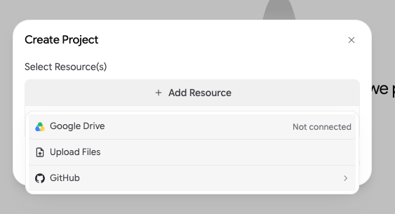

- GitHub 저장소: OAuth 인증을 마치면 클라우드 환경으로 저장소를 가져와 코드를 읽고 수정하며, 테스트 후 Pull Request를 여는 작업까지 처리합니다.
- Google Drive 파일: 드라이브에 올려둔 문서나 스프레드시트를 프로젝트에 붙여 참고 자료로 활용합니다.
- 직접 업로드한 파일: 내 컴퓨터에 있는 파일을 프로젝트로 바로 올릴 수 있습니다. 파일 하나당 최대 8 MiB, 프로젝트당 최대 50개(총 100 MiB), 계정 전체 기준 최대 2 GiB까지 지원합니다.
- Antigravity Marketplace 플러그인: GitHub, Google Drive, Docs, Sheets, Slides, Calendar, Gmail 같은 외부 서비스 플러그인을 연결해 에이전트가 할 수 있는 작업 범위를 넓힐 수 있습니다.

### 시작하고 이어서 작업하는 법

개발 지식이 없어도 웹 브라우저나 데스크톱 앱에서 몇 번의 클릭으로 시작할 수 있습니다. `antigravity.google.com`이나 Antigravity App 왼쪽 메뉴의 `Projects` 옆 폴더 추가 버튼을 누르고 `Create Project`에서 `Add Resource`로 GitHub 저장소, Google Drive 파일, 로컬 파일을 연결합니다.

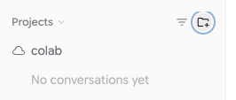

생성을 마치면 위 화면처럼 클라우드 아이콘과 함께 원격 프로젝트가 사이드바에 등록됩니다. 이제 해당 프로젝트를 선택한 상태에서 평소 채팅하듯 원하는 작업을 입력하면 됩니다.

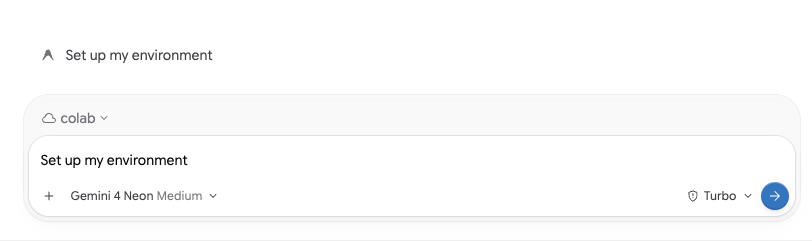

작업을 보내면 Google 클라우드 가상 환경 안에서 에이전트가 필요한 도구를 설치하고 파일을 작성한 뒤 자체 검증 결과까지 정리해 보여줍니다. 변경된 파일이 있다면 하단의 `Review` 버튼으로 세부 내역을 바로 검토할 수 있습니다.

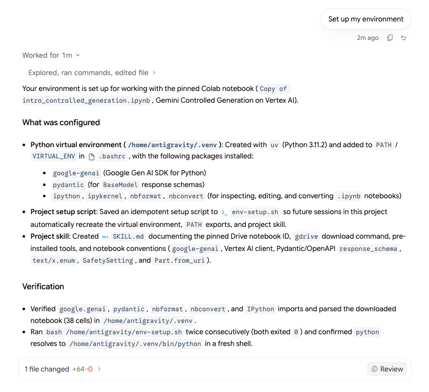

환경이 준비된 뒤에는 실제 코드 점검이나 문서 수정 같은 후속 작업을 자연어로 이어서 요청할 수 있습니다. 예를 들어 Google Drive에 연결해 둔 Colab 노트북의 코드와 라이브러리 버전을 점검해 달라고 요청하면, 에이전트가 구버전 설정과 오류를 찾아 고친 뒤 변경 요약을 정리해 줍니다.

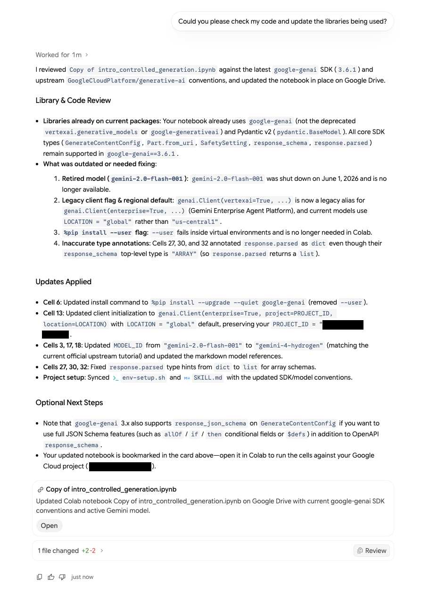

수정 내용은 클라우드 안에만 머물지 않고 연결해 둔 Google Drive 원본 파일에 바로 반영됩니다. 실제 Google Drive 목록을 열어보면 에이전트가 작업한 시각에 맞춰 해당 파일이 업데이트되어 있는 것을 확인할 수 있습니다.

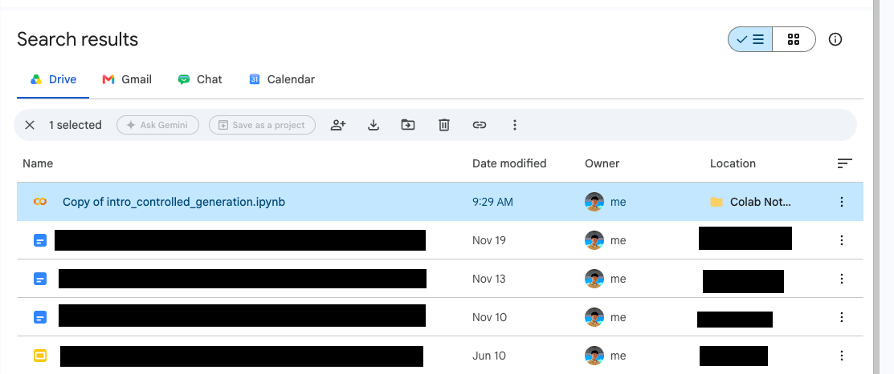

터미널 환경에 익숙한 개발자라면 Antigravity CLI에서 바로 원격 세션을 열 수 있습니다.

```bash
# 새 Remote Agent 세션 시작
agy --remote-agent

# 이전 Remote Agent 대화 이어서 열기
agy --remote-agent -c
```

기기 사이 전환도 간편합니다. 데스크톱 앱에서 시작한 작업을 퇴근길 스마트폰 브라우저에서 확인하고 승인할 수 있고, 웹에서 진행하던 프로젝트를 나중에 데스크톱 앱에서 열어 이어서 작업할 수도 있습니다.

### AGENTS.md로 작업 규칙 정하기

`AGENTS.md`는 에이전트가 작업을 시작할 때마다 자동으로 참고하는 상시 지침서입니다. 매번 프롬프트에 같은 주의 사항을 반복해서 적을 필요 없이, 프로젝트의 기본 원칙을 파일 하나에 정리해 두는 용도로 씁니다. 웹 UI 자체에 별도의 `AGENTS.md` 전용 편집 메뉴가 따로 있지는 않지만, 아래 방법으로 파일 기반 규칙을 그대로 적용할 수 있습니다.

- 비개발자 활용 예: 보고서 문체(한국어 존댓말 사용), 문서 구성 순서(요약, 본론, 다음 할 일), 숫자·날짜 표기 기준, 출처 없는 추정 금지 같은 작성 원칙을 적어둡니다.
- 개발자 활용 예: 코드 스타일, 필수 테스트 실행 규칙, 사용 금지 라이브러리, 커밋·PR 작성 규칙을 적어둡니다.

Remote Agents에서 `AGENTS.md`를 적용하는 방법은 두 가지입니다.

1. GitHub 저장소에 포함하기: 연결할 저장소의 최상단(또는 특정 하위 폴더)에 `AGENTS.md`나 `.agents/rules/*.md` 파일을 커밋해 둡니다. Remote Agent가 저장소를 클라우드 작업 공간으로 불러올 때 해당 규칙을 자동으로 읽어 적용하므로, 팀원 모두가 같은 기준으로 일할 수 있습니다.
2. 프로젝트 안에서 직접 추가하기: 별도 저장소가 없다면 프로젝트에 `AGENTS.md` 파일을 업로드하거나, 채팅창에 원하는 작업 원칙을 말하고 "`AGENTS.md` 파일로 저장해 줘"라고 요청해 만들 수 있습니다.

상위 폴더와 하위 폴더에 규칙 파일이 함께 있을 때는 어느 한쪽이 덮어쓰이지 않고 누적되어 함께 반영됩니다.

### Skills로 반복 업무 절차 묶기

`AGENTS.md`가 모든 대화에 항상 적용되는 기본 규칙이라면, `Skills`는 특정 업무를 처리할 때만 꺼내 쓰는 단계별 매뉴얼입니다. 주간 보고서 작성, 회의록 정리, 코드 리뷰, 데이터 전처리처럼 정해진 순서와 템플릿이 있는 반복 업무를 스킬로 만들어 두면 매번 길게 설명하지 않아도 일정한 품질의 결과를 얻을 수 있습니다.

Antigravity의 스킬은 폴더 안에 `SKILL.md` 파일을 두고, 필요하면 보조 스크립트(`scripts/`)나 참고 양식(`references/`)을 함께 묶는 개방형 구조를 따릅니다.

```text
.agents/skills/weekly-report/
├── SKILL.md
└── references/
    └── template.md
```

`SKILL.md` 상단에는 스킬 이름(`name`)과 언제 쓰는지(`description`)를 적고, 본문에 구체적인 실행 절차를 적습니다.

```markdown
---
name: weekly-report
description: 회의 메모와 문서를 바탕으로 팀 주간 보고서 초안을 작성할 때 사용합니다.
---

# 주간 보고서 작성 절차

1. 연결된 문서에서 이번 주 완료 항목과 진행 중 항목을 분리합니다.
2. 일정 지연이나 의사결정이 필요한 사항을 상단 요약에 먼저 적습니다.
3. references/template.md 양식에 맞춰 초안을 정리합니다.
```

스킬을 여러 개 등록해 두어도 에이전트가 모든 매뉴얼을 처음부터 한꺼번에 읽지는 않습니다. 평소에는 각 스킬의 이름과 짧은 설명만 가볍게 파악하고 있다가, 관련 요청이 들어오거나 사용자가 `/<스킬명>`으로 직접 호출할 때만 해당 `SKILL.md` 본문을 불러옵니다. 덕분에 대화가 길어져도 불필요한 정보로 작업 흐름이 흐트러지지 않습니다.

Remote Agents에서는 GitHub 저장소의 `.agents/skills/` 경로에 스킬을 넣어두거나, 앞서 본 환경 설정 예시 화면처럼 에이전트에게 "이 프로젝트의 환경 구성과 작업 절차를 `SKILL.md`로 만들어 줘"라고 지시해 프로젝트 전용 스킬을 자동으로 생성하고 다음 세션에서 재사용할 수 있습니다.

직접 폴더나 파일을 만들지 않고도 채팅으로 공개 스킬을 바로 설치할 수 있습니다. 아래 모바일 화면처럼 채팅창에 원하는 스킬 설치를 요청하면 에이전트가 원격 환경에 스킬을 등록하고 바로 `/humanizer` 같은 명령으로 사용할 수 있게 준비해 줍니다.

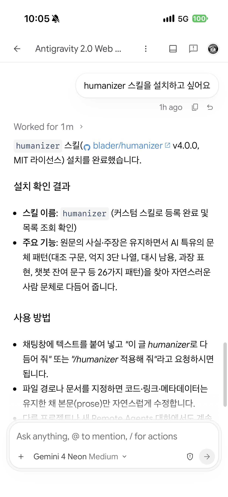

### Customizations에서 외부 커넥터 연결하기

에이전트가 텍스트로 답하는 수준을 넘어 실제 외부 도구에 들어가 문서를 읽고, 시트를 수정하고, GitHub Pull Request를 올리려면 외부 커넥터 연결이 필요합니다. Antigravity Web에서는 좌측 사이드바의 `Customizations` 메뉴에서 이 작업을 처리합니다.

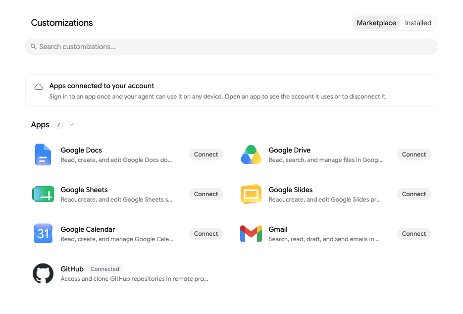

1. 좌측 메뉴에서 `Customizations`를 열고 `Marketplace` 탭으로 이동합니다.
2. GitHub, Google Drive, Docs, Sheets, Slides, Calendar, Gmail 등 필요한 외부 앱(플러그인)을 찾습니다.
3. 앱 카드의 `Connect` 버튼을 눌러 OAuth 로그인 인증을 마칩니다. 별도 로그인이 필요 없는 앱은 `Ready` 상태로 바로 쓸 수 있습니다.
4. 연결이 완료된 앱은 `Connected` 목록에 표시되며, 각 앱을 열어 연결된 계정을 확인하거나 연결을 해제·재연결할 수 있습니다.

`Customizations` 메뉴로 직접 이동하지 않고 대화창에서 바로 연결할 수도 있습니다. 아래 모바일 화면처럼 채팅창에 연동하고 싶은 서비스를 말하면 에이전트가 인라인 연동 카드를 띄워 주고, 카드에서 바로 OAuth 인증을 마칠 수 있습니다.

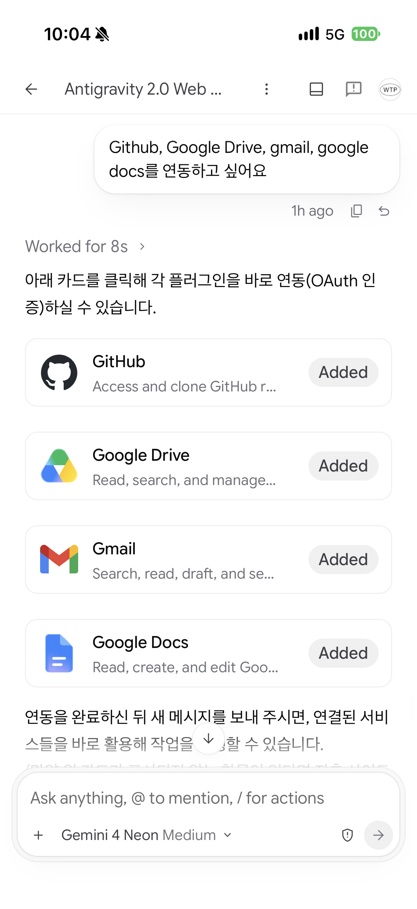

`Customizations`에서 연결한 앱은 특정 PC가 아니라 사용자의 Google 계정에 저장됩니다. 한 번만 연결해 두면 회사 PC, 집 노트북, 스마트폰 브라우저 어디서 Remote Agents를 열더라도 같은 커넥터를 그대로 활용할 수 있습니다.

### 보안과 데이터 관리

Remote Agents의 모든 작업은 사용자별로 격리된 Google 관리 클라우드 환경에서 실행됩니다. GitHub이나 Google Workspace 플러그인을 연결할 때 쓰는 OAuth 인증 토큰은 암호화되어 저장되며, 승인된 서비스 호출이 필요할 때만 주입됩니다.

중요한 변경이나 외부 반영 전에는 에이전트가 먼저 권한 확인을 요청합니다. 원격 에이전트에 쌓인 대화 기록과 데이터를 모두 지우고 싶을 때는 계정 설정의 `Delete All Remote Agents Data` 메뉴에서 영구 삭제할 수 있습니다.

### 이용 조건

Remote Agents는 개인 Google 계정으로 Google AI Pro 또는 Google AI Ultra 요금제를 구독 중인 사용자에게 순차 제공됩니다. 현재 무료 플랜, Google AI Plus, Google Workspace 및 Google Cloud 비즈니스 계정에서는 지원되지 않습니다.

## Remote Control

Remote Control은 내 컴퓨터에서 이미 실행 중인 Antigravity App이나 CLI 세션에 웹 브라우저로 원격 접속해 제어하는 기능입니다. 클라우드 서버에 새로 환경을 꾸리는 대신, 내 컴퓨터를 안전한 원격 창으로 열어주는 방식입니다.

내 컴퓨터에만 있는 환경을 그대로 써야 할 때 특히 유용합니다. 아직 GitHub에 올리지 않은 작업 파일, 로컬 컴퓨터에만 저장된 문서, 개인 PC에서 띄워둔 테스트용 웹사이트(`127.0.0.1`), 로컬 환경 변수 파일(`.env`), 직접 설치해 둔 전문 도구들을 클라우드로 옮기지 않고도 원격에서 다룰 수 있습니다. VPN을 깔거나 공유기 포트 포워딩, SSH 터널을 따로 설정할 필요 없이 Google 계정 로그인만으로 연결됩니다.

### 웹과 모바일에서 할 수 있는 일

`antigravity.google.com`에 접속하면 내 컴퓨터 화면 앞에 앉아 있을 때와 비슷한 흐름으로 에이전트를 다룰 수 있습니다.

- 실시간 확인과 조작: 프롬프트 입력, 에이전트의 작업 계획서, 도구 실행 내역, 수정된 파일 비교 내역이 실시간으로 표시됩니다.
- 권한 승인과 응답: 에이전트가 명령 실행 허가를 요청하거나 추가 질문을 던질 때 스마트폰이나 다른 PC에서 바로 답해 작업이 멈추지 않게 이어갈 수 있습니다.
- 여러 기기 전환: 사무실 데스크톱, 집 노트북, 별도 개발 서버처럼 여러 대의 컴퓨터에 Antigravity를 켜두었다면 웹 화면의 Instance Switcher에서 원하는 기기를 골라 오갈 수 있습니다.
- 모바일 푸시 알림: 스마트폰 브라우저에서 `antigravity.google.com`을 연 뒤 브라우저 메뉴의 "홈 화면에 추가"로 웹 앱을 설치해 두면, 에이전트가 작업을 마치거나 사용자 확인이 필요할 때 알림을 받을 수 있습니다.

### 설정 방법

Antigravity App을 쓰는 일반 사용자라면 설정 화면에서 스위치 하나만 켜면 준비가 끝납니다. 웹의 `Remote Control` 메뉴에 처음 들어가면 아래처럼 3단계 연결 안내가 표시됩니다.

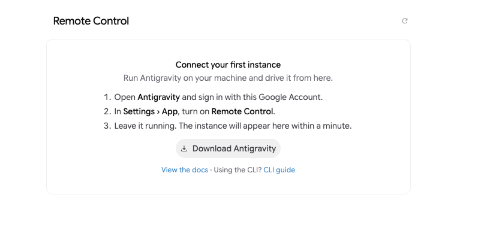

1. 호스트로 쓸 컴퓨터에서 Antigravity App을 열고 Google 계정으로 로그인합니다.
2. `Settings > App` 메뉴로 이동해 `Remote Control`을 켭니다. 여러 대의 컴퓨터를 쓴다면 알아보기 쉽게 기기 이름을 지정해 둡니다.
3. 앱을 실행해 둔 상태로 기다리면 보통 1분 안에 웹의 `Remote Control` 목록에 기기가 나타납니다.
4. 다른 PC나 스마트폰 브라우저에서 `antigravity.google.com`에 같은 Google 계정으로 로그인한 뒤 목록에서 내 기기를 선택합니다.

터미널이나 화면이 없는 서버에서 Antigravity CLI를 쓰는 개발자라면 두 가지 방식으로 연결할 수 있습니다. 터미널이 열려 있는 동안만 임시로 연결하려면 대화창에서 `/remote-control`을 입력하거나 `agy --remote-control` 명령으로 실행합니다. 서버를 백그라운드 서비스로 계속 켜두고 싶다면 아래 명령으로 데몬을 관리합니다.

```bash
# 백그라운드 원격 제어 서비스 시작 (기기 이름 지정 가능)
agy remote-control start --name my-workstation

# 연결 상태 확인
agy remote-control status

# 서비스 중지
agy remote-control stop
```

### 보안 원칙과 동작 조건

Remote Control은 호스트 컴퓨터와 원격 브라우저가 모두 동일한 Google 계정으로 로그인되어 있어야만 연결됩니다. 파일과 환경 변수, 인증 정보는 클라우드로 복사되지 않고 호스트 컴퓨터 안에 그대로 머뭅니다. 에이전트가 터미널 명령을 실행하거나 파일을 수정할 때도 호스트에 설정된 권한 정책이 그대로 적용됩니다.

실제 작업이 호스트 컴퓨터에서 돌아가기 때문에, 원격으로 접속하려는 동안에는 해당 컴퓨터의 전원이 켜져 있고 절전 모드로 들어가지 않았으며 인터넷에 연결된 상태여야 합니다. 컴퓨터가 꺼지거나 네트워크가 끊기면 아래 화면처럼 목록에 `Offline`으로 표시되며, 호스트가 다시 온라인 상태가 되면 이어서 접속할 수 있습니다.

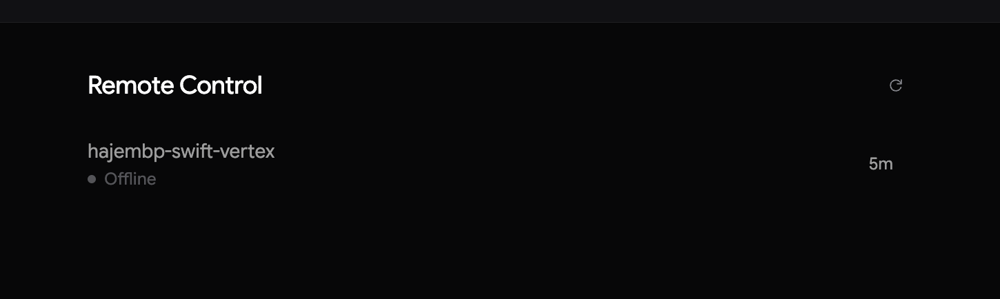

## 상황별 선택 기준

작업 파일이 어디에 있는지, 내 컴퓨터를 계속 켜둘 수 있는지에 따라 두 기능을 나눠 쓰면 됩니다. `antigravity.google.com`의 Instance Switcher를 이용하면 한 브라우저 안에서 Remote Agents와 Remote Control 기기를 필요할 때마다 바로 전환할 수 있습니다.

- 노트북을 끄고 이동하거나 퇴근한 뒤에도 작업이 계속 돌아가야 한다면 Remote Agents가 맞습니다. GitHub 저장소의 기능 수정과 테스트, Google Drive 문서 기반의 자료 정리처럼 클라우드 자료만으로 충분한 업무에 잘 어울립니다.
- 회사나 집 컴퓨터에 저장된 로컬 파일, 아직 클라우드에 올리지 않은 초안, 로컬 테스트 서버나 전용 하드웨어가 필요한 작업이라면 Remote Control을 선택합니다. 자리에서 잠시 벗어나 있는 동안 스마트폰으로 진행 상황을 보고 승인만 눌러주기 좋습니다.

웹 브라우저 대신 데스크톱 Antigravity App에서 원격 Linux 서버나 GPU 서버에 직접 개발 환경을 붙이고 싶은 개발자라면, OpenSSH로 서버를 연결해 프로젝트와 터미널을 원격 호스트에서 실행하는 `Connect over SSH` 기능도 함께 활용할 수 있습니다.

## 공식 문서

- Antigravity Web: https://antigravity.google.com
- Google Antigravity 공식 문서: https://antigravity.google/docs
- Remote Agents 문서: https://antigravity.google/docs/remote-agents
- Remote Control 문서: https://antigravity.google/docs/remote-control
- Rules 문서: https://antigravity.google/docs/rules
- Skills 문서: https://antigravity.google/docs/skills
- Plugins 문서: https://antigravity.google/docs/plugins
- Google Antigravity 공식 Codelabs: https://codelabs.developers.google.com/?product=antigravity
